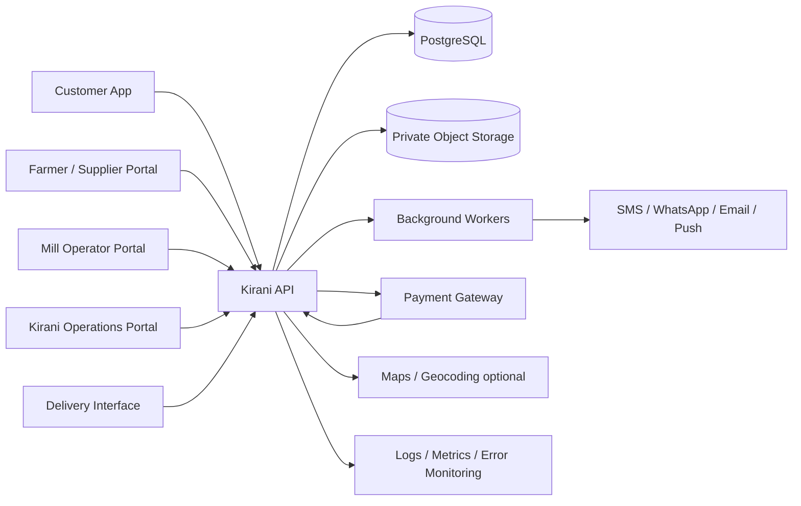
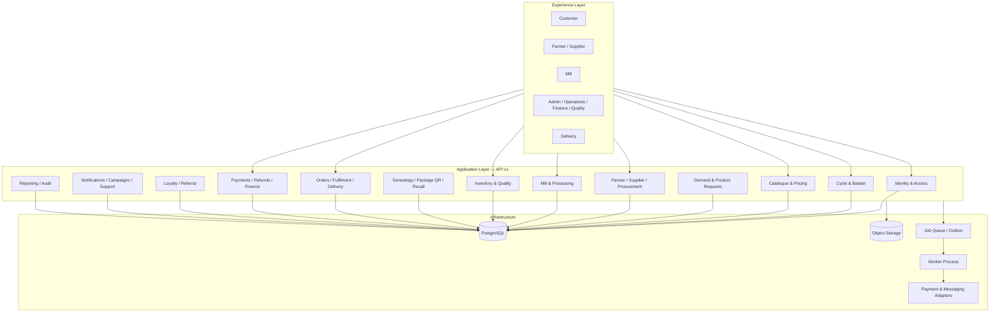
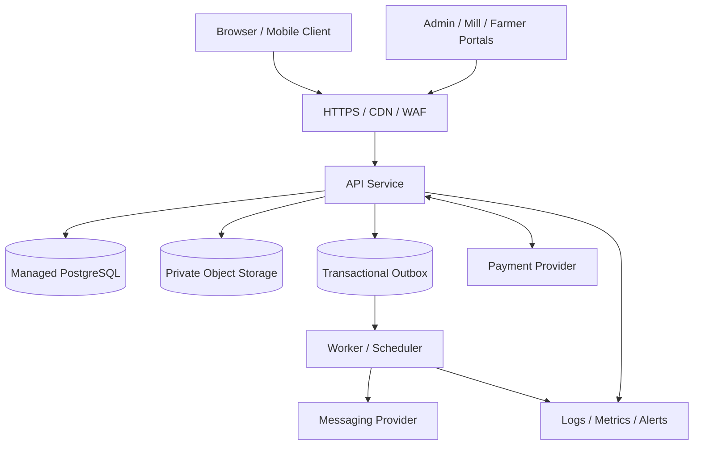

# Kirani Phase 1 — System Architecture

**Version:** 1.0 | **Status:** Proposed baseline

## 1. Architecture decisions
- Start with a **modular monolith** and one PostgreSQL database. Do not introduce microservices before independent scaling/team/availability needs justify the operational cost.
- Separate customer, farmer/supplier, operations and mill interfaces, but reuse shared identity, design system, API client and domain contracts.
- Keep business logic in domain/application services; controllers must not own business rules.
- Use transactional outbox + background workers for notifications, campaign delivery, exports and provider reconciliation.
- PostgreSQL is the system of record for orders, payments, stock, genealogy, loyalty and audit. Object storage holds documents, images and evidence.
- Integrations are adapters, never embedded directly into domain workflows.
- Batch genealogy and financial ledgers are append-only; current state is a projection.

## 2. Context diagram

## 3. Logical component architecture

## 4. Domain/module responsibilities

| Module | Owns | Must not own |
|---|---|---|
| Identity & Access | users, invitations, roles, permissions, sessions, MFA | business-specific approvals |
| Catalogue & Pricing | categories, products, pack options, price versions, claims | stock quantity |
| Cycle & Basket | cycle calendar, recurring versions, one-time baskets, confirmation snapshot | supplier procurement |
| Demand | demand aggregation, customer product requests, sourcing demand | purchase commitment |
| Partner & Procurement | farmer/supplier profiles, listings, offers, POs, receipts, payables | processing stage execution |
| Mill & Processing | facility, stage templates, jobs, stage events, outputs and reconciliation | customer order pricing |
| Inventory & Quality | balances, movements, inspections, holds and release | public source disclosure |
| Traceability | genealogy, package allocations, public QR projection and recall | unrestricted PII |
| Order & Fulfilment | order lifecycle, picking, packing, delivery | payment gateway truth |
| Payments & Finance | payment events, refunds, COD, settlements, expenses | order fulfilment state |
| Loyalty | policy versions, earning lots, ledger and redemption allocations | payment provider state |
| Communications | templates, preferences, campaigns, delivery logs, support | authoritative order/stock changes |
| Reporting & Audit | read models, exports, audit events | bypassing domain write services |

## 5. Deployment topology

Pilot deployment should use:
- One stateless API service (scale horizontally if needed).
- One worker process/service for scheduled and asynchronous jobs.
- Managed PostgreSQL with automated backups and private networking where supported.
- Private object storage for identity documents, quality evidence, product media and delivery proof.
- CDN only for public, non-sensitive static assets; private assets use short-lived signed URLs.
- Payment and messaging provider endpoints over TLS.
- Centralized structured logs, error monitoring, uptime/health checks and alert routing.
- Separate development, staging/UAT and production environments with separate credentials/data.

This is a logical deployment view, not a commitment to a specific hosting vendor. Select providers based on India data handling, cost, backup/restore, network controls and operational support.

## 6. Runtime and transaction patterns
- Use a single transaction for customer confirmation + order snapshot + inventory/demand reservation as applicable.
- Use row-level locking or optimistic version checks for cycle cutoff, stock reservation, redemption and payment/refund state changes.
- Enforce unique idempotency key per tenant/actor/operation scope; persist request hash and result.
- Write domain state and outbox event in the same DB transaction. Worker delivers outbox event with retries and deduplication.
- External provider calls occur outside long-running DB transactions; persist intent before call and reconcile provider result.
- Processing stage completion writes inputs, outputs, genealogy edges, movements, quantity reconciliation and audit in one transaction.
- Use decimal arithmetic for quantity and integer minor units for money; no floating-point financial calculations.

## 7. Integration architecture
- Payment adapter: create payment intent, verify webhook, query transaction, refund, reconcile.
- Notification adapters: send template, delivery status callback, retry and provider throttling.
- Object storage adapter: upload initiation, content validation, private object, signed download.
- QR adapter: create signed/opaque token and printable label payload.
- Maps adapter optional: geocode delivery address and assist route planning; delivery must work if maps provider is unavailable.
- Every adapter has timeout, bounded retry, circuit-breaker/backoff where appropriate, correlation ID and redacted logs.

## 8. Security boundaries
- Customer can access own profile, baskets, orders, payments and tickets only.
- Farmer/supplier can access own profile/listings/responses/deliveries/payables only.
- Mill user can access only assigned facility/jobs and permitted stage transitions.
- Delivery operator can access assigned stops/orders/packages only.
- Quality, finance and procurement permissions are separated where possible.
- Admin MFA and maker-checker approval for sensitive operations.
- Public trace service reads a curated projection, never raw relational records.
- Private uploads are never served from a public bucket.
- Audit data is access-controlled and corrections are appended, not overwritten.

## 9. Observability and operations
Structured log fields: timestamp, level, service, environment, request_id/correlation_id, actor_id (non-secret), route, status, latency, domain entity reference and safe error code. Never log passwords, OTPs, access tokens, full payment credentials, bank details or private documents.

Metrics/alerts: API availability/latency/error rate; DB saturation/connections/slow queries; worker lag/failures/dead letters; payment callback failures; notification failures; stock reservation conflicts; processing reconciliation exceptions; backup age; storage capacity.

## 10. Growth path
Extract a module only when it has clear independent scaling, release ownership or reliability needs. Candidate future extractions: notification delivery, reporting/analytics, payment reconciliation, media processing. Keep database ownership boundaries and domain events explicit from day one. Multi-tenant/franchise support is not assumed in Phase 1; do not add tenant complexity without a business decision.

## 11. Architecture decisions requiring sign-off
- Final customer delivery form: responsive PWA/web or shared native app.
- Hosting provider/region and database provider.
- Payment gateway and supported payment modes.
- SMS/WhatsApp/email/push provider and template approval process.
- Object storage provider and retention.
- Target concurrency, availability objective, RPO/RTO and support coverage.
- Whether offline mill/delivery capture is required in the pilot.
