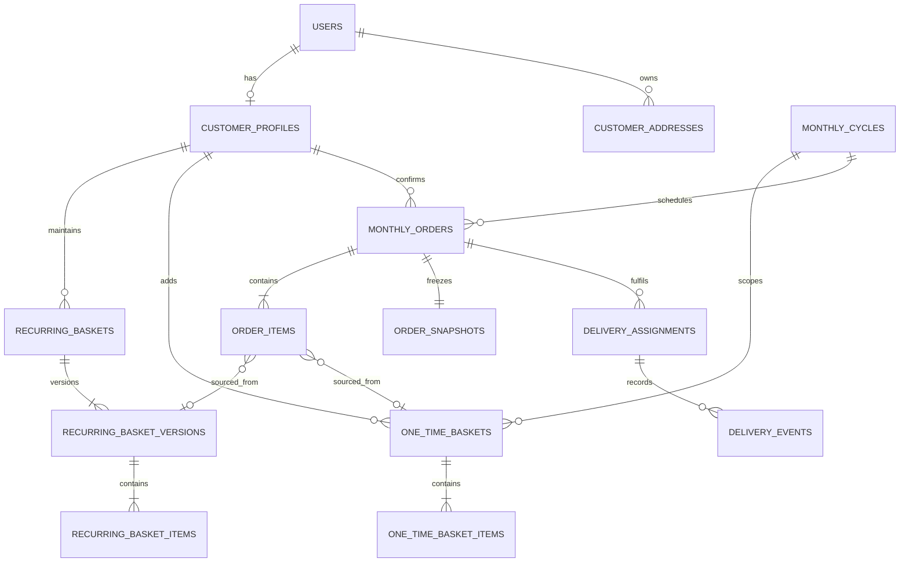
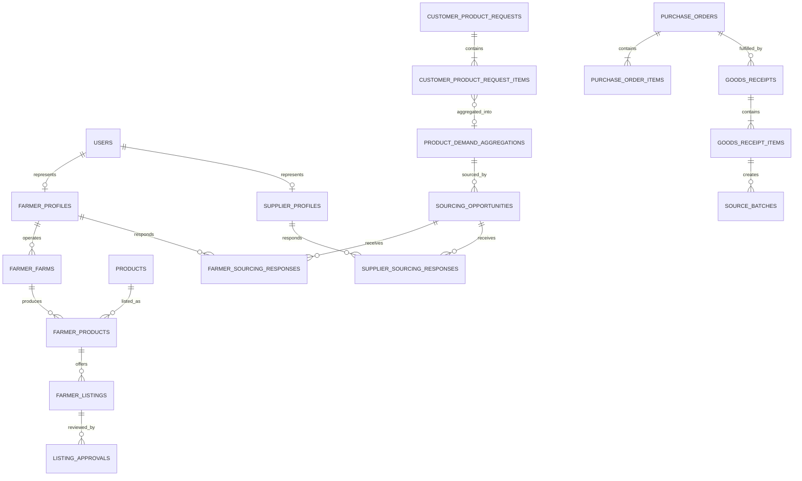
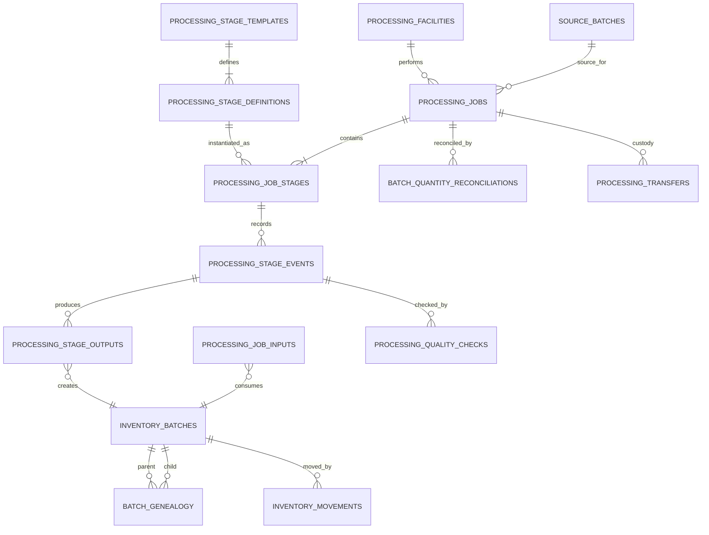
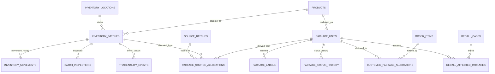
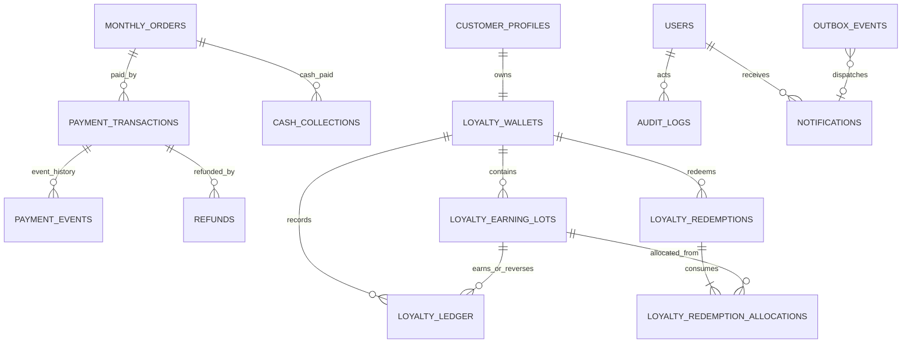

# Kirani Phase 1 — Entity Relationship Diagrams

Diagrams are logical. Full columns, constraints and indexes are in [Database Design](04-DATABASE-DESIGN.md). Mermaid source is maintained here so changes can be reviewed in Git.

## 1. Customer, baskets, cycle and orders

**Important:** recurring and one-time items are separate before confirmation but consolidate into a single monthly order. Order lines retain basket_type and source version; the snapshot freezes customer-confirmed commercial terms.

## 2. Farmer/supplier sourcing and procurement

A sourcing response is not a purchase order. Only an authorized Kirani buyer creates a PO. Preserve the original individual customer requests when aggregating demand.

## 3. Mill processing and source genealogy

Genealogy is a directed acyclic graph. A child output batch can have multiple parent inputs only for an explicitly authorized merge. The default is source-specific processing jobs. Stage output types distinguish saleable output, recoverable by-product, waste and reject.

## 4. Inventory, packages, QR and recall

Package-source allocation must reconcile to package net quantity. QR token resolves a curated public view; it does not expose raw database entities or sensitive records.

## 5. Payments, loyalty and audit

Each loyalty earning lot stores its original conversion value. Redemption allocations preserve the lot-level conversion used. Payment and fulfilment states remain independent.

## 6. Relationship invariants to enforce
- One active recurring basket per customer (or enforce explicit active status uniqueness).
- At most one one-time basket per customer and monthly cycle.
- One immutable order snapshot per confirmed order.
- Order item source references must agree with basket_type and effective cycle.
- Every processing output batch has genealogy to one or more consumed inputs.
- No genealogy cycles; no consumption beyond available quantity.
- Source batch identity is not overwritten by processing output identity.
- Every package allocation references released saleable inventory and approved source genealogy.
- Package allocations reconcile to net package quantity.
- Recall descendant traversal follows genealogy and package allocation edges.
- Payment provider event and idempotency uniqueness prevents duplicate financial effects.
- Loyalty lot consumption cannot exceed remaining points and preserves historical conversion.
